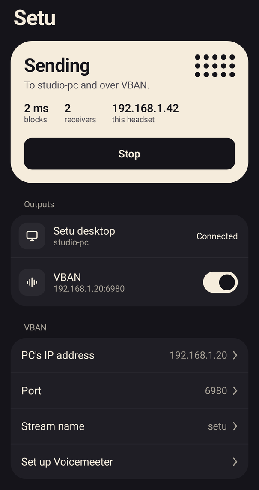
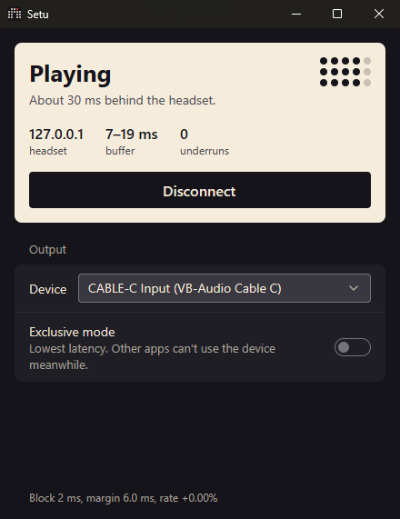
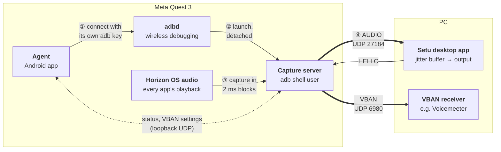
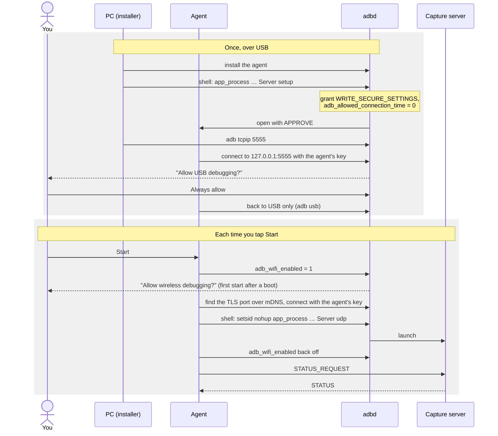

<p align="center">
  <picture>
    <source media="(prefers-color-scheme: dark)" srcset="design/brand/setu-icon-dark.svg">
    
  </picture>
</p>

<h1 align="center">Setu</h1>

<p align="center">
  <b>Your Meta Quest's audio, on your PC.</b><br>
  <sub>Setu (सेतु) means "bridge".</sub>
</p>

<p align="center">
  
  
  
  
</p>

<p align="center">
  <a href="#quick-start">Quick start</a> ·
  <a href="#how-it-works">How it works</a> ·
  <a href="#vban">VBAN</a> ·
  <a href="#measurements">Measurements</a> ·
  <a href="#build">Build</a> ·
  <a href="#roadmap">Roadmap</a>
</p>

---

Setu streams a Meta Quest 3's audio to a PC with as little delay as the headset allows: about
20 ms behind the headset's own speakers over USB and 25–35 ms over Wi-Fi, as measured on an
earlier prototype (estimates, see [Measurements](#measurements)). The headset keeps playing while
it streams. Play it with Setu's desktop app, or with any [VBAN](#vban) receiver such as
Voicemeeter.

<p align="center">
  
  &nbsp;
  
  <br>
  <sub>The agent on the headset, sending, and the desktop app on the PC, playing it.</sub>
</p>

<p align="center">
  <a href="https://setu.trugamr.dev"><b>Install on your Quest</b></a> ·
  <a href="https://github.com/Trugamr/setu/releases/latest"><b>Download for Windows</b></a> ·
  <a href="#build">Build it yourself</a>
</p>

**Status: work in progress.** Streaming, VBAN and both apps work. The desktop app asks for the
headset's address, as it can't find the headset on its own yet.

## Quick start

Needs a headset in Developer Mode, a USB cable, and a Windows PC with Chrome or Edge.

1. **Once, over USB:** connect the headset, open [setu.trugamr.dev](https://setu.trugamr.dev)
   and choose Connect.
   On the headset, choose "Always allow from this computer" each time it asks. Unplug the cable.
2. **On the headset:** open Setu (Library, under Unknown sources) and tap Start. The first start
   after each boot asks to allow wireless debugging on this network; choose Allow.
3. **On the PC:** download `setu-<version>-windows-x64.zip` (`arm64` for an Arm PC) from the
   [latest release](https://github.com/Trugamr/setu/releases/latest), extract it and run
   `setu.exe`. Enter the headset's address and connect; the agent shows it under VBAN, as
   "IP address from".
   - The exe isn't code-signed, so Windows SmartScreen warns about it: choose More info, then
     Run anyway.
   - Allow Setu through Windows Firewall when it asks, at least on private networks. Without
     that it receives nothing.

To play through Voicemeeter instead of the desktop app, see [VBAN](#vban). To build it
yourself, see [Build](#build): `task agent:setup` and `task desktop:run` take the place of
steps 1 and 3.

## How it works



Low-latency capture needs a process running as the adb shell user, and only adbd starts those.
So the agent, an ordinary app, connects to its own headset's adbd over wireless debugging and
launches the capture server through it (① ②). The server is detached, so it keeps running after
the agent turns wireless debugging off again. It captures playback in 2 ms blocks (③), where
Android's default is 40 ms, and sends each block to the desktop app and to a VBAN receiver (④).
The PC needs no adb.

| Piece | What it is |
|---|---|
| Agent (`apps/agent`) | Android app, Kotlin and Compose. Starts and stops the capture server, shows its status and keeps it in step with the settings, such as where to send VBAN. |
| Capture server (`apps/agent/.../server`) | Java, shipped inside the agent's APK and run with `app_process` using the APK as its classpath. Captures playback and streams it to the desktop app and to a VBAN receiver. |
| Desktop app (`apps/desktop`) | Rust, with a [GPUI](https://www.gpui.rs) window and `setu-cli`. Receives the stream and plays it. Windows first, then Linux. |
| Protocol (`protocol`) | The wire format, with byte fixtures that the Java and Rust sides both test against. |
| Browser installer (`apps/web`) | A page that installs the agent over WebUSB and runs the setup routine inside its APK (`Server setup`), so it and `task agent:setup` cannot drift apart. |

### Starting the server

Wireless debugging only accepts adb keys the headset has already allowed, so setup has the
headset allow the agent's key once, over USB. After that the agent starts the server on its own.



Setup is a routine inside the APK, `Server setup`, run as the shell user: it grants
`WRITE_SECURE_SETTINGS`, so the agent can turn wireless debugging on, sets
`adb_allowed_connection_time` to `0`, so an allowed key never expires (the default is 7 days),
and opens the agent to approve its key. The agent then waits for adbd's legacy TCP port, which
only the PC can open, because only that port shows the "Allow debugging?" prompt for an unknown
key. An allowed key is accepted over USB, legacy TCP and wireless debugging alike. The agent
asks again until `dumpsys adb` shows the key remembered, then returns adbd to USB, so an
installer knows setup finished when `service.adb.tcp.port` reads 0 again.

### Streaming

The desktop app sends HELLO to the server's UDP port every 0.5 s. The server answers with FORMAT
and streams AUDIO to whichever receiver sent HELLO most recently; when HELLOs stop for 3 s it
releases the capture. Each AUDIO datagram carries its frame position, so a lost datagram plays as
silence of the right length instead of stalling for a retransmit, and the stream passes the PC's
firewall as reply traffic. The desktop app's jitter buffer then holds as little audio as the
measured jitter allows (see [Receiver design notes](#receiver-design-notes)). The
[protocol spec](protocol/README.md) has the details.

### Horizon OS limits on wireless debugging

- **One tap per boot.** Trusted Wi-Fi networks are cleared at every boot, so the first start
  after a boot shows Meta's "Allow wireless debugging" dialog. Horizon OS writes system XML as
  text (`persist.sys.binary_xml=0`); AOSP's keystore reader then treats the whitespace after
  `<keyStore>` as a tag and skips every entry. Allowed adb keys survive because they are
  reloaded from `adb_keys`. Within a boot, Wi-Fi drops and sleep recover silently.
- **Not at boot by itself.** Android tries to restore wireless debugging before Wi-Fi is up and
  gives up, so the agent has to turn it on after Wi-Fi connects.
- **Unknown keys over TLS are rejected without a prompt.** Only legacy TCP (`adb tcpip`) shows
  the "Allow debugging?" prompt, which is why setup uses it once.
- The adb shell holds `MANAGE_DEBUGGING`, so it can trust a network with no dialog
  (`IAdbManager.allowWirelessDebugging`, the server's `adb-wifi-trust` command).
- "Allow USB debugging?" has an "Always allow from this computer" button where Android has a
  checkbox. Allow admits the key only until adbd restarts, so setup needs that button.
- The Quest Link PC service can stop the "Allow USB debugging?" prompt from appearing; stop it
  while setting up. Toggling Developer Mode in the phone app clears USB authorizations.

## What we learned about Horizon OS audio

- App audio goes through render-only policy mixes to `AUDIO_DEVICE_OUT_BUS` devices, into Meta's
  own audio engine (`media.has`, inside `audioserver`), which mixes in 4 ms blocks.
- Android gives each stream one primary mix and adds every `LOOP_BACK_RENDER` mix as a secondary
  output. Quest's bus mixes are primary, so a `LOOP_BACK` capture loses and records silence,
  while a `LOOP_BACK_RENDER` capture coexists with normal playback. This is why scrcpy's default
  audio source is silent on Quest and `--audio-source=playback --audio-dup` works.
- **The capture block size equals the AudioRecord buffer.** `AudioPolicy.createAudioRecordSink()`
  asks for 1920 frames, so capture runs in 40 ms blocks. Building the AudioRecord directly
  (REMOTE_SUBMIX preset, `addr=<registration>` and `fixedVolume` tags) with a 96-frame buffer
  gives 2 ms blocks. 48 frames is too small: delivery turns into irregular clumps. The sample
  rate does not change the period.
- The VOICE_COMMUNICATION capture preset gives a sink that never receives audio; REMOTE_SUBMIX
  works.
- Capture stops while the headset sleeps. For testing off-head:
  `am broadcast -a com.oculus.vrpowermanager.prox_close`, undone with
  `am broadcast -a com.oculus.vrpowermanager.automation_disable`.
- A shell process can take `WIFI_MODE_FULL_LOW_LATENCY` locks, but Android honors them only for
  a foreground app, and they did not reduce jitter.

### Measurements

Headset side, from a click's presentation time to it being readable by the server (`probe`,
6 clicks each, other audio paused):

| Capture block | Presented → readable |
|---|---|
| 1920 frames (40 ms, Android's default) | 24.0 ms |
| 384 frames (8 ms) | 8.0 ms |
| 192 frames (4 ms) | 7.0 ms |
| 96 frames (2 ms) | 6.3 ms |

Every block size from 96 to 3840 frames arrived on a steady clock (`bursts`; e.g. 96 frames
every 1.9–2.1 ms). Arrival jitter at the PC, as each block's deviation from its nominal spacing:

| Transport | Typical | Worst seen |
|---|---|---|
| USB (adb forward, TCP) | 1–2 ms | 5.6 ms |
| Wi-Fi 6 at −42 dBm, PC wired (UDP) | 6–20 ms | 38.7 ms |

The end-to-end figures at the top add the measured buffer levels to the headset-side delay; true
speaker-to-ear latency has not been measured. Virtual audio mixers on the PC can add delay of
their own, so play to a hardware output for the lowest latency.

### Other approaches and why they fell short

| Approach | Result |
|---|---|
| scrcpy with `--audio-source=playback --audio-dup` | Works, about 80–100 ms behind: 40 ms capture blocks plus scrcpy's buffering. |
| Meta casting | Users report seconds of audio delay. |
| Bluetooth to the PC | 150 ms or more. |
| An ordinary app with MediaProjection | Needs consent each session; whether it gets small capture blocks is untested. |
| A 3.5 mm cable to line-in | Lowest latency, and the fallback. |

## VBAN

[VBAN](https://vb-audio.com/Voicemeeter/VBANProtocol_Specifications.pdf) is VB-Audio's protocol for audio over UDP. With
it, a PC needs no Setu software: Voicemeeter, VBAN Receptor or any other VBAN receiver can play
the headset. VBAN has no handshake, so the headset sends to an address it is given:

1. In the agent, turn on "Send to a VBAN receiver" and enter the PC's IP address. The port (6980)
   and stream name ("setu") can stay as they are.
2. On the PC, add an incoming VBAN stream with the stream name and the "IP address from" that the
   agent shows. In Voicemeeter that is Menu → VBAN.
3. Allow the receiver through the PC's firewall for UDP on that port.

The server sends VBAN from the same capture as the Setu stream, so both can play at once. The
agent sends its settings to the server (SET_VBAN) and corrects the server whenever its status
differs, which covers a server that restarts. From a PC, `task agent:server -- udp --vban
<pc-ip>` starts the server with a target. Until VBAN is configured in the agent, the agent takes
over that target as its settings; once it is configured, the agent's settings win.

Compared with the desktop app:

- **Delay is set by the receiver.** VBAN receivers keep a fixed network buffer, while Setu's
  playout adapts to the jitter it measures and corrects clock drift. Voicemeeter's buffer is 3 ×
  max(its audio buffer, the Net Quality floor), and at least 1536 samples (32 ms at 48 kHz); the
  Optimal floor is 512 samples. So the lowest delay needs Net Quality at Optimal, Voicemeeter's
  output buffer at 512 samples or less, and Voicemeeter at 48 kHz to skip resampling. Raise Net
  Quality only if the stream crackles.
- **Unicast only.** Send to the PC's own address: Wi-Fi delivers broadcast and multicast at a low
  rate and without retries.
- **No audience check.** The server captures for as long as VBAN is on, whether anyone listens or
  not.

## Receiver design notes

These come from the prototype receiver; the desktop app's playout follows them.

- **The jitter buffer controls its minimum, not its average.** Block arrivals make the buffer
  level a sawtooth, and latency is set by its bottom. Playback rate is nudged (±0.5 %, linear
  interpolation) so the minimum over each 0.5 s window settles at the target.
- **It steers what an on-time datagram would find, not the level itself.** Each datagram's
  lateness is its transit (arrival minus stream time) above the lowest transit of the last 2 s.
  The level it finds plus its lateness is what it would have found on time, which does not move
  with jitter, so the controller does not chase each late datagram.
- **Target** = margin + jitter allowance, at most 40 ms beyond the deadband. The allowance is
  the worst lateness of the last 2 minutes among datagrams no more than 40 ms late, leaving out
  the backlog behind a longer delay, which costs less as an occasional dropout than as constant
  latency. It rises before playback restarts, so a stall's own burst is kept for it, and falls
  at 2.5 ms/s, slowly enough to shed by rate without a skip unless clock drift already takes
  more than half the ±0.5 %. A datagram over 100 ms late marks an outage, not jitter. In
  simulation, 15–35 ms stalls every 10 s gave 3 underruns in 20 minutes instead of 27, for 7 ms
  more delay.
- **Deadband of min(block, output period).** The measured minimum moves by up to that much as
  arrivals drift against the output's pull grid; without the deadband the controller oscillates.
- **Margin** = configured margin (2 ms by default) + min(block, period). It grows 2 ms per
  underrun that no late datagram explains, such as an output pulling in a burst, within the
  target's ceiling, and decays 0.5 ms after each 15 s without one. A delay explains an
  underrun when the datagram the buffer ran dry waiting for arrives about a target late.
- **The controller is proportional**, so an output whose clock drifts settles above the target
  by about 20 ms per 1 % of drift: 0.2 ms for a typical 100 ppm, but several ms for a virtual
  device that runs 0.3 % slow.
- **After an underrun, refill to one block, one output period and the target**, not a fixed
  amount, and drop whatever arrives beyond that before playing again, so a stall costs latency
  only while it lasts. The target is the level after a pull, so before one it needs a period
  more.
- **No abrupt edges.** Playback fades out over 1 ms before the buffer runs dry, from a 1 ms
  reserve, and fades in over 2 ms when it restarts. A skip fades out, jumps and fades in, and
  where the stream breaks (a lost datagram's silence, or a capture restarting) the audio either
  side fades too. The reserve has a cost: a delay that drains the buffer to within 1 ms of empty
  dips the level briefly, where without it the audio would have played on untouched.
- **UDP over Wi-Fi.** Each datagram carries its frame position, so a lost datagram becomes
  silence of the right length instead of a retransmit stall. The receiver sends HELLO and the
  server answers, which also passes desktop firewalls as reply traffic. The server marks its
  datagrams DSCP CS6, which the headset's Wi-Fi sends as voice (WMM AC_VO), as it does EF. For
  a PC on Wi-Fi, most access points map CS6 to voice and EF to video; one following RFC 8325
  maps CS6 to best effort.
- **The desktop's threads on the audio path run as "Pro Audio" under MMCSS.** The output
  thread at critical priority, as any delay there is a gap; the link thread at high, as a delay
  there stamps a datagram late and counts as jitter, which the buffer covers with latency.

## Repository layout

| Path | What |
|---|---|
| `apps/agent` | The agent app: `Agent` is the screen's logic, with the server and settings behind `CaptureServer` and `SettingsStore`. `.../server` is the capture server, where `ReceiverSession` sends each block to every route in `Routes` (the Setu receiver, the VBAN target) in its `PacketFormat`. `.../protocol` holds the shared protocol module and the VBAN encoder. |
| `apps/desktop` | The desktop app, a member of the root Cargo workspace. `Receiver` wires `link` (UDP to the server), `playout` (jitter buffer) and `output` (the device, WASAPI on Windows). `Session` is the app around it: the settings, the receiver while connected, and the commands that change them. The window (`main.rs`, `ui.rs`) and `setu-cli play` host a session; `control` lets `setu-cli` drive the running one over 127.0.0.1. |
| `apps/web` | The browser installer: React, Tailwind and Motion on Vite, with [Tango](https://tangoadb.dev) for adb over WebUSB. `setup.ts` is the flow, `page.ts` what each state shows, `webusb.ts` the adapter and `components/` the page, styled only with the brand's tokens in `style.css`. The tests run the flow against a fake headset. In development the page serves the agent's latest build, and `?status=` with a status as JSON shows any state without a headset. |
| `design/brand` | The icon, colours and the scripts that generate every icon file ([design/brand/README.md](design/brand/README.md)). |
| `docs/screenshots` | The screenshots above: the agent's Sending preview from `task agent:screenshots`, cropped, and the desktop window while playing. |
| `protocol` | Protocol spec ([protocol/README.md](protocol/README.md)) and byte fixtures. |

## Build

Needs [Task](https://taskfile.dev), JDK 21, the Android SDK (`ANDROID_HOME`, default
`~/Android/Sdk`), Rust, and Node with pnpm for the browser installer. The Taskfile targets WSL:
the agent builds with Linux tools, while the desktop app and adb use their Windows binaries
(see the variables at the top of `Taskfile.yml`).

```bash
task build                    # agent APK and desktop app
task test                     # JVM, Rust and browser installer tests
task agent:install            # install the agent on a USB-connected headset
task agent:setup              # install, then the one-time setup (see Quick start)
task web:dev                  # serve the browser installer at http://localhost:5173
task web:build                # build it, with the agent's APK, into apps/web/dist
task agent:server -- probe 6  # run the server's latency probe from the installed APK
task desktop:run              # open the desktop app's window
task desktop:cli -- devices   # list output devices
task desktop:cli -- play <headset-ip>   # play without a window; --help lists the options
```

`setu-cli` also controls the Setu already running on the PC, the window or a `play`, through
a control port on 127.0.0.1. Each command prints the app's state as `key=value` lines and
exits non-zero when the command fails:

```bash
task desktop:cli -- status              # phase, title, headset, device, stats, ...
task desktop:cli -- connect <headset-ip>   # or no address for the saved one
task desktop:cli -- device realtek      # part of a device name; no name for the default
task desktop:cli -- exclusive on
task desktop:cli -- disconnect
```

Server commands (`task agent:server -- <command>`): `udp [port] [blockFrames] [--vban
host[:port][/name]]`, `adb [blockFrames]`, `probe [clicks] [blockFrames]`,
`bursts [seconds] [blockFrames]`, `adb-wifi-trust <bssid>`, `adb-revoke-keys`, `setup`. The agent
launches `udp` with the defaults and logs to `/data/local/tmp/setu-server.log`. A new server ends
any Setu server holding its port.

### Releases

CI (`.github/workflows/ci.yml`) tests and builds the agent, the browser installer and the
desktop app on every push to main and every pull request.

The version lives in `Cargo.toml` (`workspace.package.version`), and the agent takes the same
one. To release, bump it in a commit, then tag that commit:

```bash
git tag v0.2.0 && git push origin v0.2.0
```

The release workflow builds the agent's APK, minified with R8 and signed with the release key,
and the desktop app for Windows x64 and arm64. It attaches them to a GitHub release, then
deploys the browser installer with that same APK to https://setu.trugamr.dev, a Cloudflare
Worker that serves only static assets (`apps/web/wrangler.jsonc`). Running the workflow by hand
(`gh workflow run release.yml`) builds everything and stops before the release and the deploy.
The secrets it needs are listed at the top of `.github/workflows/release.yml`.

## Roadmap

1. Desktop app: a tray icon, so it can play with the window closed.
2. A PC installer inside the desktop app, taking the same steps as the browser installer.
3. Discovery and receiver approval, start at login, a Linux backend. For VBAN: fill in the PC's
   address from the last Setu receiver, and find VBAN receivers with VBAN's PING0 service.

Open questions:

- Is browser audio ahead on the PC? Browsers play through a deep buffer that the capture path
  does not show.
- Approving a waiting adb key from the shell (`IAdbManager.allowDebugging`) would remove the
  tap during setup; untested.
- Measure true end-to-end latency by clock-syncing headset and PC over the stream.

## Credits

- Playback capture and the shell-process workarounds are adapted from
  [scrcpy](https://github.com/Genymobile/scrcpy) (Apache-2.0).
- The wireless-debugging approach follows [Shizuku](https://github.com/RikkaApps/Shizuku)
  (Apache-2.0).
- AOSP sources consulted: `AdbDebuggingManager.java` and `AdbService.java` in
  `frameworks/base`, `daemon/auth.cpp` in `packages/modules/adb`, and `adbd_auth.cpp` in
  `frameworks/native`.

## License

[MIT](LICENSE). Files adapted from scrcpy say so at the top and keep its
[Apache-2.0](https://www.apache.org/licenses/LICENSE-2.0) license.
