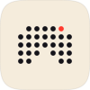
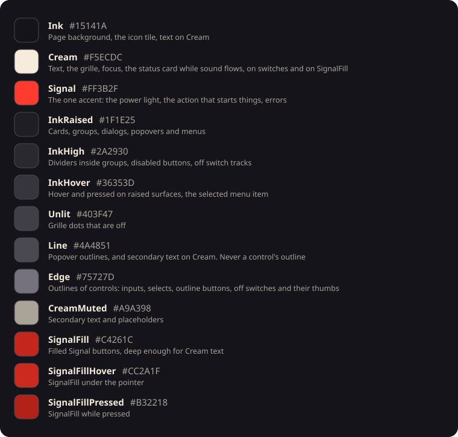

# Setu brand

 

Setu means "bridge". The mark is a speaker grille with an arch cut out of it: sound and a bridge
in one shape. The top corners are dropped, so the grille also reads as a headset seen from the
front, with the arch as the nose gap. One red dot is the power light.

## Colours



Three brand colours, Ink, Cream and Signal, and the UI steps between them. The apps are dark
only.

- **Signal is the one accent**, used once per view where possible, the way the icon uses one red
  dot among twenty-eight cream ones: the action that starts things (Start, Connect) and errors.
  Switches, outputs, status and focus are never red.
- **Focus is Cream.** The focus ring, the text cursor and selected text are Cream, so a field
  being typed in never looks like an error.
- **Cream means sound is flowing.** The status card turns Cream, with Ink text, while the
  headset sends or the desktop plays. While on but waiting for the other side, the card keeps
  its Ink fill with a Cream outline. Off and problems use the plain card.
- **Don't say it with colour alone.** Every state has its own title and sentence, and a problem
  says what went wrong in that sentence, in Signal.
- **Ink text on Signal**, never Cream: cream on red is 3:1.
- **Edge outlines controls.** Anything you can type in, pick or switch is outlined in Edge,
  which keeps 3:1 against every surface.
- **Unlit is a grille dot that is off.** The grille in the status card uses it, so its shape
  shows without competing with the lit dots.

`palette.py` holds the tokens and the contrast each pairing must keep. `generate.py` checks
those first and writes nothing if one falls short, then writes `Palette.kt` and `colors.xml`
for the agent, `palette.rs` for the desktop app, `palette.svg`, and the tables below.

<!-- palette:start (Generated by design/brand/generate.py from design/brand/palette.py; edit those instead.) -->
| Token | Hex | Use |
| --- | --- | --- |
| Ink | `#15141A` | Page background, the icon tile, text on Signal and on Cream |
| Cream | `#F5ECDC` | Text, the grille, focus, the status card while sound flows, and on switches |
| Signal | `#FF3B2F` | The one accent: the power light, the action that starts things, errors |
| InkRaised | `#1F1E25` | Cards, groups, dialogs, popovers and menus |
| InkHigh | `#2A2930` | Dividers inside groups, disabled buttons, off switch tracks |
| InkHover | `#36353D` | Hover and pressed on raised surfaces, the selected menu item |
| Unlit | `#403F47` | Grille dots that are off |
| Line | `#4A4851` | Popover outlines, and secondary text on Cream. Never a control's outline |
| Edge | `#75727D` | Outlines of controls: inputs, selects, outline buttons, off switches and their thumbs |
| CreamMuted | `#A9A398` | Secondary text and placeholders |
| SignalHover | `#FF5A4F` | Signal under the pointer |
| SignalPressed | `#F0382C` | Signal while pressed |

Contrast, checked by `generate.py`:

| Foreground | Background | Contrast | Needs | Where |
| --- | --- | --- | --- | --- |
| Cream | Ink | 15.62:1 | 4.5:1 | Body text |
| Cream | InkRaised | 14.10:1 | 4.5:1 | Text on cards, dialogs and menus |
| Cream | InkHover | 10.33:1 | 4.5:1 | Text on a hovered or selected menu item |
| CreamMuted | Ink | 7.31:1 | 4.5:1 | Secondary text, placeholders |
| CreamMuted | InkRaised | 6.59:1 | 4.5:1 | Secondary text on cards |
| CreamMuted | InkHigh | 5.75:1 | 4.5:1 | A disabled button's label |
| CreamMuted | InkHover | 4.83:1 | 4.5:1 | Secondary text on a hovered item |
| Ink | Cream | 15.62:1 | 4.5:1 | Text on the status card while sound flows |
| Line | Cream | 7.67:1 | 4.5:1 | Secondary text on that card |
| Cream | Ink | 15.62:1 | 4.5:1 | The Stop button on that card |
| Signal | Ink | 5.16:1 | 4.5:1 | Error text |
| Signal | InkRaised | 4.66:1 | 4.5:1 | Error text on a card or in a dialog |
| Ink | Signal | 5.16:1 | 4.5:1 | Primary button label |
| Ink | SignalHover | 5.95:1 | 4.5:1 | Primary button label, hovered |
| Ink | SignalPressed | 4.63:1 | 4.5:1 | Primary button label, pressed |
| Cream | Cream 25% over Ink | 7.48:1 | 4.5:1 | Selected text |
| Cream | Cream 25% over InkRaised | 6.61:1 | 4.5:1 | Selected text on a card or in a dialog |
| Edge | Ink | 3.89:1 | 3.0:1 | Input, select and outline button outlines |
| Edge | InkRaised | 3.51:1 | 3.0:1 | Control outlines on a card, the off switch |
| Edge | InkHigh | 3.06:1 | 3.0:1 | The off switch thumb on its track |
| Cream | InkRaised | 14.10:1 | 3.0:1 | The on switch track, the outline of the status card while waiting, focus on a card |
| Ink | Cream | 15.62:1 | 3.0:1 | The on switch thumb on its track |
| Cream | Ink | 15.62:1 | 3.0:1 | The focus ring and the text cursor |
| Signal | Ink | 5.16:1 | 3.0:1 | The power light |
| Unlit | InkRaised | 1.59:1 | 1.4:1 | Grille dots that are off |
| Ink 20% over Cream | Cream | 1.52:1 | 1.4:1 | Level meter dots that are off, on the status card |
<!-- palette:end -->

## Shape and spacing

Both apps share the palette, the type scale, the layout and the wording. Corner radii and padding
follow each platform, because a shape is never rounder than the one around it, and the outermost
shape is the platform's: a phone screen or Quest panel is about 48 round, a Windows 11 window 8.

| | Agent (Android, Quest) | Desktop (Windows) |
|---|---|---|
| Status card | 32 | 8 |
| Groups | 24 | 8 |
| Buttons, fields, icon tiles | 12 | 4 |
| Card padding | 20 | 16 |
| Margin to the window edge | 16 | 16 |

On the agent the radii nest: 48 − 16 margin = 32 for the card, and 32 − 20 padding = 12 for
the button inside it. Switches are fully round on both.

Spacing is on a 4 grid: 4 between lines that belong together (a title and its sentence), 16
between groups of content, and the card's padding before its button. Type, in px or sp:

| Role | Size / line height |
|---|---|
| Status title, the headset's address | 28 / 34 (desktop 26 / 32) |
| Row title | 16 / 22 (desktop 14 / 20) |
| Sentence | 15 / 22 (desktop 14 / 20) |
| Label, secondary line | 13 / 18 |

The values live in `Dimens.kt` (agent) and `dimens.rs` (desktop).

## The mark

- A 7 × 5 grille on a 9-unit grid, centred in a 100-unit tile, dots of radius 2.9. It spans
  60 × 42 units, which leaves about 20 units of clear space on every side.
- An arch of radius 23, centred at (50, 78), removes the dots at the bottom centre.
- The two top-corner dots are dropped.
- The top row's rightmost dot, at (68, 32), is Signal.

It comes in two themes, and Signal is the same in both:

- **Dark**, the default: Cream dots on an Ink tile. The app icons use it.
- **Light**: Ink dots on a Cream tile, for light backgrounds such as the README in light mode.

Keep the dots round and flat: no gradients, shadows or outlines. Use only these two colourings
of the grille, and don't move the red dot.

At 16 px the full mark blurs, so `setu-icon-16-{theme}.svg` redraws it on the pixel grid: two-pixel dots
on a three-pixel pitch, same silhouette, same red dot. Each theme has one.

## Files

Each file comes as `-dark` and `-light`.

| File                          | What                                                           |
| ----------------------------- | -------------------------------------------------------------- |
| `setu-icon-{theme}.svg`       | The app icon: mark on its tile                                 |
| `setu-mark-{theme}.svg`       | The mark alone, transparent: dark for Ink backgrounds, light for Cream |
| `setu-icon-16-{theme}.svg`    | The 16 px cut                                                  |
| `png/{theme}/setu-icon-*.png` | Exports from 16 to 1024 px (16 px from the 16 px cut)          |
| `setu-{theme}.ico`            | Windows icon, 16 to 256 px. The desktop app embeds the dark one |

The agent's launcher icon (`apps/agent/src/main/res`) is an adaptive icon built from the same
mark, with a monochrome layer for themed icons.

Everything here comes from `generate.py`, which also writes the launcher icon. To change the mark,
change it there and run both scripts. `render.py` needs Chromium.

```sh
python3 design/brand/generate.py
python3 design/brand/render.py
```

The explorations that led here are in `design/icons/` (round 9 is the last).
